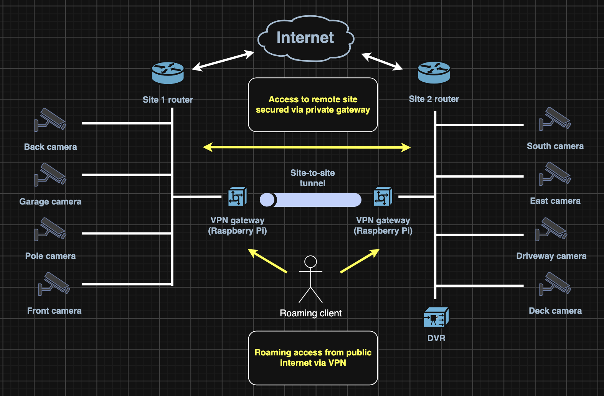
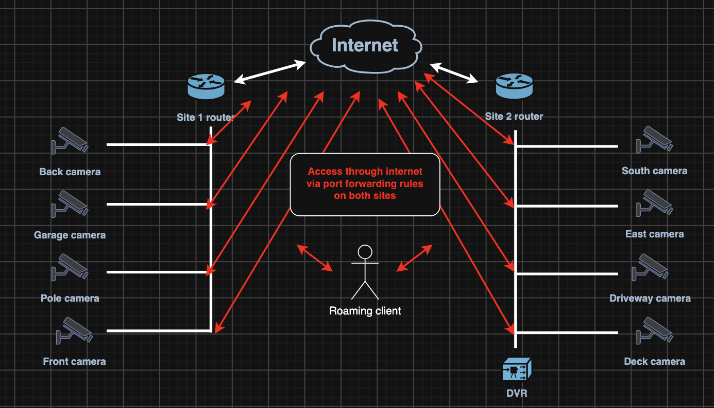

+++
date = '2026-11-03T16:10:00-05:00'
draft = false
title = 'Securing a dual-site consumer DVR system'
description = "Locking down security camera access and video archival via implementing a site-to-site VPN in consumer hardware"
+++

# Background

I was presented with an existing IP security camera system deployed to two sites, connected to a DVR in one of the sites. The DVR software was responsible for archiving captured security footage as well as presenting a dashboard to access live camera feeds.

To manage remote access to the DVR, its management interface was port-forwarded to the public internet. To manage access between the DVR and the cameras not on its site, all the cameras were port-forwarded to the public internet as well.

There were a few security issues with this approach:

- Because the IP cameras were exposed to the public internet, anyone with the public IP address and credentials, or a method of obtaining them, would be able to view the live camera feeds.
- Exposing the DVR over the public internet results in the same risk, but for historical footage. Additionally, the DVR could access all cameras’ live feeds indirectly.
- Because the DVR is a general purpose Windows computer and some of the IP cameras were past their support contracts, exposing them to the public internet increases the risk of compromise and control (e.g., botnet).

# Solution

The following alternate architecture was proposed and ultimately adapted:

Two Raspberry Pi 5 devices were used to create a secure tunnel between sites, allowing both clients and cameras in both networks to write to the DVR and to be accessed safely without exposing them to the public internet. The same software used to create the tunnel also allowed secure remote access to either network by any client presenting the proper keys.

Additionally, monitoring software was installed on both devices to track reliability of the camera system over time.

